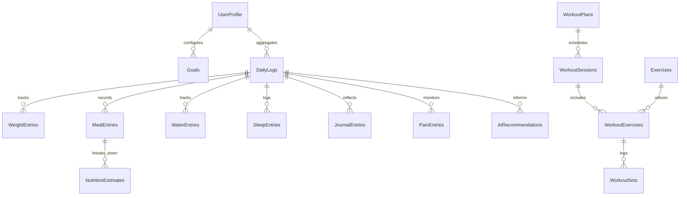

# Sthira (स्थिर) — Personal AI Fitness & Nutrition Coach
### Comprehensive Technical Architecture & Functional Specification

> **Dedicated with reverence to the Supreme Divine:**  
> **"नारायणाय समर्पितम्"** *(Dedicated to Lord Narayana)*

---

## 1. Executive Summary & Brand Identity

### 1.1 The Meaning of "Sthira"
**Sthira (स्थिर)** is a classical Sanskrit term rooted in Patanjali's *Yoga Sutras* (`sthira-sukham asanam` — *posture should be steady and joyful*). In the context of strength, hypertrophy, and lifestyle transformation, **Sthira** represents:
- **Steadfastness**: Unwavering consistency over transient motivation.
- **Physical Poise**: Structural stability, joint longevity, and progressive overload without injury.
- **Mindful Calm**: An antidote to hyperactive, dopamine-driven "gym bro" fitness apps.

### 1.2 Visual & Spiritual Aesthetics
- **Emblem**: **Kamal (कमल / Sacred Lotus)**, symbolizing purity, grounded growth, and spiritual beauty amidst physical effort.
- **Ambient Presence**: A faint, ethereal, meditative background presence of **Lord Narayana (विश्वरूप / Sheshashayi Vishnu)** seamlessly woven into the design system, reminding the user that body and mind are sacred offerings.
- **UI Tone**: Dark, calm slate `#0B0F17` and elevated navy `#141D2B` with emerald `#10B981` accents, clean cards, generous whitespace, subtle status pills (`ON TRACK`, `ATTENTION`, `NEEDS ACTION`), and zero aggressive gamification.

---

## 2. Core Architectural Principles

### 2.1 The "Measured vs. Estimated" Principle
The foundational premise of Sthira is strict ontological separation between ground-truth empirical measurements and AI/mathematical estimates:

| Category | Measured Data (Ground Truth) | Estimated Data (Derived / Predictive) |
|---|---|---|
| **Body Mass** | Exact scale weigh-ins (e.g. 64.1 kg) | Exponential Moving Average (EMA) trend curve (e.g. 64.12 kg) |
| **Nutrition** | Weighed food grams, verified ingredients | Caloric approximations, macronutrient ratios, AI confidence |
| **Training** | Exact bar weight lifted (kg), reps performed | Target load progressions, RIR estimates, volume accumulation |
| **Recovery** | Recorded sleep hours, time to bed | Morning Readiness Score (0–100%), recovery capacity |
| **Review** | Weekly set counts, completed sessions | Calorie adaptation recommendations, trajectory finish dates |

> **Rule**: An estimate is **never** presented as an exact fact. Every estimate in the application carries an explicit visual indicator badge (`ESTIMATED TREND`, `ESTIMATED RECOMMENDATION`, `ESTIMATED SCORE`).

### 2.2 Local-First & Offline Architecture
- Core operational logic is executed locally on the device using **SQLite** (`expo-sqlite` on native iOS/Android and a deterministic synchronous fallback on Web).
- Mathematical calculations (Exponential Moving Averages, progressive overload weight steps, readiness scores, and calorie adjustments) are computed in TypeScript rather than being delegated to LLM prompt hallucinations.

---

## 3. Target User Persona: Jay

| Attribute | Specification |
|---|---|
| **Current Weight** | 64.0 kg |
| **Target Weight** | 67.0 kg (+3.0 kg lean bulk) |
| **Height** | 167 cm |
| **Target Velocity** | 0.10–0.20 kg/week (ideal: **~0.15 kg/week**) to maximize skeletal muscle hypertrophy while strictly tempering adipose storage |
| **Dietary Profile** | 100% Vegetarian |
| **Egg Exclusion** | **NO** (Strictly 0 eggs) |
| **Mushroom Exclusion** | **NO** (Strictly 0 mushrooms) |
| **Permitted Foods** | Onion (YES), Garlic (YES), Dairy (Paneer, Greek yogurt, Curd/Dahi, Milk, Cheese, Halloumi, Whey), Legumes, Tofu, Edamame, Grains |
| **Cuisine Preferences** | Indian, Mexican, Mediterranean, Italian, Asian, Middle Eastern |
| **Weekly Training Split** | • **Monday**: Upper Body A<br>• **Tuesday**: Yoga & Mobility<br>• **Wednesday**: Lower Body A<br>• **Thursday**: Upper Body B<br>• **Friday**: Lower Body B<br>• **Saturday**: Rest & Recovery<br>• **Sunday**: Swimming & Active Recovery |
| **Daily Targets** | **Calories**: ~2,450 kcal<br>**Protein**: 110–125 g (~120g)<br>**Fat**: 65–80 g (~70g)<br>**Carbohydrates**: ~335 g<br>**Water**: 2.0–2.5 Liters<br>**Sleep**: 7.5–8.5 Hours |

---

## 4. SQLite Database Architecture (The 22 Tables)

Sthira employs a relational SQLite database structure comprising 22 tables designed for zero-latency local queries:



### Table Directory
1. **`UserProfile`**: Core demographic data, current/target weight, dietary flags (`eats_eggs`, `eats_mushrooms`, `eats_onion`, `eats_garlic`), and weekly schedule.
2. **`Goals`**: Targets for daily calories, protein range, fat range, carbs, water, sleep, and workouts.
3. **`DailyLogs`**: Date-indexed master roll-up tracking daily totals (calories, protein, carbs, fat, water, scale weight, sleep, subjective ratings, and coach status).
4. **`WeightEntries`**: Granular scale weigh-in log with date, weight in kg, and notes.
5. **`MealEntries`**: Meal diary records categorizing breakfast, lunch, dinner, snack, and confidence score.
6. **`FoodItems`**: Vegetarian food reference library with calorie, protein, carbohydrate, fat, and fiber densities.
7. **`NutritionEstimates`**: Itemized ingredients parsed from natural language meals with confidence scores.
8. **`WaterEntries`**: Timestamped water intake records (ml).
9. **`SleepEntries`**: Measured sleep duration (minutes), quality rating, and notes.
10. **`JournalEntries`**: Morning readiness intentions and evening wind-down reflections with extracted sentiment and themes.
11. **`Exercises`**: Exercise catalog containing equipment, muscle groups, target sets/reps, instructions, common mistakes, and progression history.
12. **`WorkoutPlans`**: 7-day scheduled weekly split templates.
13. **`WorkoutSessions`**: Workout session execution logs tracking date, start/end time, duration, status (`in_progress`, `completed`), and exertion difficulty.
14. **`WorkoutExercises`**: Junction table mapping exercises to a session in sequential order.
15. **`WorkoutSets`**: Performed sets containing set number, weight (kg), reps, RIR (reps in reserve), and completion flag.
16. **`Activities`**: Non-gym activities (Yoga, Swimming, Walking, Cycling).
17. **`PainEntries`**: Joint and muscular fatigue logs (body area, pain level 0–10, notes).
18. **`AIRecommendations`**: Historical AI coach advice, action items, and rationale.
19. **`WeeklyReviews`**: Weekly progress summaries, weight change, average calories/protein, and calorie adaptation decisions.
20. **`MonthlyReviews`**: Monthly trajectory evaluations and strength progression milestones.
21. **`CuisineRecipes`**: Authentic vegetarian recipes across 6 world cuisines with macro breakdowns.
22. **`AppSettings`**: Key-value application configuration and user preferences.

---

## 5. Module-by-Module Functional Deep Dive

---

### Module 1: Dashboard & Hub (`src/features/dashboard/`)

#### Purpose
The central command center providing an immediate, high-clarity snapshot of today's status without cognitive clutter.

#### Key Components & Functionality
- **`TodayOverviewCard.tsx`**:
  - Displays circular progress metrics for Calories, Protein, Water, and Weight.
  - Dynamically calculates remaining macros and hydration deficit against Jay's baseline targets.
- **`TodayWorkoutCard.tsx`**:
  - **Dynamic State Engine**:
    - `IN PROGRESS`: Displays live active session timer, completed sets count, and accumulated volume in kg.
    - `COMPLETED`: Displays workout duration, total kg lifted, perceived difficulty badge, and exercises summary.
    - `PLANNED`: Displays scheduled plan for today (e.g. Upper Body A) with exercise list and a prominent **"Start Workout"** launcher.
    - `REST DAY`: Displays active recovery encouragement on Saturdays and Sundays.
- **`CoachSummaryCard.tsx`**:
  - Renders the latest holistic AI coach message, current compliance status (`ON TRACK`, `ATTENTION`, `NEEDS ACTION`), and priority focus for today.
- **`QuickActionsGrid.tsx`**:
  - 6 tactile action buttons: **Log Meal**, **Active Workout**, **Log Weight**, **Morning Check-In**, **Log Water (+250ml)**, and **Pain / Joint Check**.
- **`QuickLogModal.tsx`**:
  - Rapid multi-metric logging modal enabling one-tap updates for water, scale weight, and sleep duration without navigating away.

---

### Module 2: Nutrition & Natural Language Food Logging (`src/features/nutrition/`)

#### Purpose
Frictionless dietary tracking tailored specifically to Jay's vegetarian diet, prioritizing accurate portion estimation, strict egg/mushroom exclusion, and international culinary variety.

#### Key Features & Functionality
1. **Natural Language Food Parser (`src/services/mealParser.ts`)**:
   - Parses natural sentences such as:
     > *"200g low fat paneer curry with 2 whole wheat rotis and 1 cup dahi"*
   - **Portion Extraction**: Accurately recognizes grams (`150g`), pieces (`2 pieces`), cups (`1 cup`), bowls, and tablespoons.
   - **Gram Scaling Engine**: Scales nutritional values linearly based on verified reference densities.
   - **Dietary Guardrail Rules**:
     - Auto-flags meat, poultry, seafood, gelatin (`NON_VEG_ALERT`).
     - Auto-flags eggs and egg derivatives (`EGG_EXCLUSION_ALERT`).
     - Auto-flags mushrooms and truffles (`MUSHROOM_EXCLUSION_ALERT`).
2. **Confidence Scoring & Kitchen Scale Overrides (`ClarificationModal.tsx`)**:
   - Scores parses as `HIGH`, `MEDIUM`, or `LOW` confidence.
   - Allows Jay to override portions with exact kitchen-scale grams or manually adjust calorie/protein values before committing to the database.
3. **Macro Rings & Gauge Card (`MacroRingsCard.tsx`)**:
   - Interactive SVG concentric rings showing calorie deficit/surplus, protein progress toward 120g target, carbohydrates, and fats.
   - Explicit `ESTIMATED DATA` badge to maintain integrity.
4. **Cuisine Exploration Feature (`CuisineExplorationSection.tsx`)**:
   - 12 authentic, high-protein vegetarian recipes curated across 6 cuisines:
     - **Indian**: Palak Paneer Bhurji with Roti, High-Protein Moong Dal Chilla, Soya Chunk Matar Pulao.
     - **Mexican**: Black Bean & Tofu Burrito Bowl, Chipotle Pinto Bean Fajitas with Guacamole.
     - **Mediterranean**: Grilled Halloumi & Lentil Greek Salad, Falafel & Edamame Hummus Plate.
     - **Italian**: Whole Wheat Penne with Red Lentil Bolognese, Ricotta & Spinach Stuffed Portobello-free Cannelloni.
     - **Asian**: Pan-Seared Firm Tofu Teriyaki Bowl, Edamame & Peanut Soba Noodle Stir Fry.
     - **Middle Eastern**: Mujadara with Spiced Chickpeas & Greek Yogurt Tzatziki, Shakshuka-Spiced Tofu Scramble.
   - **One-Tap Diary Logging**: Tapping "Log Meal to Diary" automatically computes servings and populates `MealEntries` and `NutritionEstimates`.

---

### Module 3: Workout, Progressive Overload & Injury Prevention (`src/features/workout/`)

#### Purpose
Structured hypertrophy training engineered around sports-science double progression, real-time rest management, exercise substitutions, and joint fatigue protection.

#### Key Features & Functionality
1. **Weekly Split Schedule**:
   - **Upper Body A**: Machine Chest Press, Lat Pulldown, Seated Cable Row, Incline Dumbbell Press, Dumbbell Lateral Raise, Triceps Pushdown, Incline Biceps Curl.
   - **Lower Body A**: Barbell Squat / Leg Press, Romanian Deadlift, Bulgarian Split Squat, Leg Extension, Seated Leg Curl, Standing Calf Raise.
   - **Upper Body B**: Overhead Barbell/Dumbbell Press, Barbell Bent-Over Row, Flat Dumbbell Bench Press, Neutral-Grip Pull-Up / Lat Pulldown, Cable Lateral Raise, Cable Face Pull, Skull Crushers.
   - **Lower Body B**: Romanian Deadlift, Leg Press, Walking Dumbbell Lunge, Hamstring Curl, Leg Extension, Seated Calf Raise.
   - **Yoga & Mobility** (Tuesday), **Active Recovery Swimming** (Sunday), **Rest** (Saturday).
2. **Active Workout Logger (`ActiveWorkoutModal.tsx`)**:
   - Real-time elapsed stopwatch with pause/resume capability.
   - Interactive exercise cards with sets table: Set #, Weight (kg), Reps, RIR (Reps in Reserve 0–4), and Completion checkmark.
   - In-modal dialogs for set additions and exercise substitutions.
3. **Automated Rest Countdown Timer (`RestTimerBanner.tsx`)**:
   - Automatically activates when a set is marked complete.
   - Features animated progress countdown, `+30s` increment, and instant skip action.
4. **Sports-Science Progressive Overload Engine (`src/services/progressiveOverload.ts`)**:
   - **Double Progression Algorithm**:
     - When all target sets hit the top of the rep range (e.g. 3 sets of 12 reps at RIR $\ge 1$):
       - **Arm & Isolation Lifts**: Increment weight by **+1.25 kg**; reset target to bottom of rep range (8 reps).
       - **Upper Body Compounds**: Increment weight by **+2.5 kg**; reset target to 8 reps.
       - **Leg & Lower Compounds**: Increment weight by **+2.5 kg to +5.0 kg**; reset target to 8 reps.
     - When RIR is 0 at the upper rep limit: Recommends **maintaining current weight** to consolidate motor control and movement quality.
     - When reps are severely below target range: Triggers **deload recommendation (-10%)**.
     - Strictly marked with `isEstimated: true`.
5. **Biomechanical Exercise Substitution Matrix (`src/services/exerciseSubstitution.ts`, `ExerciseSubstitutionModal.tsx`)**:
   - Instantly suggests matched alternatives if gym equipment is occupied or joint discomfort occurs:
     - Machine Chest Press $\leftrightarrow$ Flat Dumbbell Bench Press $\leftrightarrow$ Push-Ups.
     - Barbell Squat $\leftrightarrow$ Leg Press $\leftrightarrow$ Hack Squat.
     - Lat Pulldown $\leftrightarrow$ Assisted Pull-Up $\leftrightarrow$ Chest-Supported Row.
   - Carries forward calibrated load guidance to prevent wasted sets.
6. **Form & Cue Guide (`ExerciseDetailModal.tsx`)**:
   - In-depth movement setup, primary muscle anatomy, step-by-step coaching cues, and critical mistakes to avoid.
7. **Joint Pain & Fatigue Tracking (`PainLoggingModal.tsx`)**:
   - Standalone and post-workout joint tracking (Shoulder, Knee, Lower Back, Elbow, Wrist, Hip).
   - **Safety Caution Guardrail**: If active pain level is $\ge 5$, progressive overload is locked and the engine automatically injects a **15% deload caution** on associated exercises.
8. **Workout Finish Flow (`WorkoutFinishModal.tsx`)**:
   - Summarizes total duration, completed set count, total volume lifted (calculated as $\sum (\text{weight} \times \text{reps})$ in kg), perceived difficulty rating (Easy / Good / Hard / Very Hard), and post-workout reflection notes.
   - Automatically synchronizes with `DailyLogs` and triggers progressive overload calculations across the database.

---

### Module 4: Progress & Analytics Engine (`src/features/progress/`)

#### Purpose
Long-term trend interpretation filtering out biological noise (water fluctuations, glycogen depletion, sodium shifts) while providing deterministic calorie adaptations.

#### Key Features & Functionality
1. **Exponential Moving Average (EMA) Weight Filter (`src/services/progressAnalytics.ts`)**:
   - Mathematical formula:
     $$\text{EMA}_t = \alpha \cdot W_t + (1 - \alpha) \cdot \text{EMA}_{t-1} \quad (\alpha = 0.1)$$
   - Allocates 10% weight to daily scale weigh-in and 90% to historical trend, eliminating day-to-day water spikes while accurately reflecting real muscle/tissue gains.
2. **Weekly Rate Velocity**:
   - Calculates 7-day rate of change velocity in kg/week based on the smoothed EMA.
3. **Interactive SVG Weight Trend Chart (`WeightTrendChart.tsx`)**:
   - Scalable SVG path rendering with gradient fills and horizontal grid ticks.
   - **Scatter Points**: Measured scale weigh-ins rendered as discrete solid circles.
   - **Trend Curve**: Estimated EMA trend rendered as a continuous emerald curve.
   - **Timeframe Selector**: `7D`, `30D`, `90D`, `ALL`.
   - Velocity indicator badge displaying current weekly rate (e.g. `+0.15 kg/wk`).
4. **Deterministic Calorie Adaptation Engine (`calculateCalorieAdaptation`)**:
   - Compares 7-day EMA velocity against Jay's target (+0.10 to +0.20 kg/week):
     - **On Track (+0.10 to +0.20 kg/wk)**: Maintains caloric target (2,450 kcal), status `ON TRACK`.
     - **Stalling (< +0.10 kg/wk)**: Increases target by **+125 kcal/day** (new target: 2,575 kcal), status `ADAPT SURPLUS`.
     - **Gaining Too Fast (> +0.20 kg/wk)**: Decreases target by **-100 kcal/day** to avoid unnecessary adipose accretion, status `TEMPER GAIN`.
     - **Compliance Guardrail**: If actual calorie intake was $< 85\%$ of target, calories are held constant with status `COMPLIANCE CHECK` (identifying undereating rather than metabolic slowdown).
   - **One-Tap Goal Update**: Tapping the action button in [`WeeklyReviewCard.tsx`](file:///Users/Divyakshit/Documents/Jay/Antigravity/Sthira/src/features/progress/components/WeeklyReviewCard.tsx) directly updates `Goals.calories_target` in SQLite.
5. **Sleep & Workout Performance Correlation Engine (`correlateSleepAndWorkout`, `SleepRecoveryCorrelationCard.tsx`)**:
   - Cross-analyzes sleep duration with workout volume:
     - Volume on $\ge 7.5\text{h}$ sleep vs. $< 7.0\text{h}$ sleep.
     - Computes differential percentage (e.g. **+18% higher volume on well-rested days**) and delivers actionable recovery recommendations.
6. **Lean Bulk Trajectory Modeling (`calculateLeanBulkTrajectory`, `LeanBulkTrajectoryCard.tsx`)**:
   - Models Jay's 64.0 kg $\rightarrow$ 67.0 kg trajectory.
   - Progress bar toward +3.0 kg target, remaining kg, projected weeks remaining at +0.15 kg/week, and projected completion date.
7. **Scale Weigh-In Modal (`LogWeightModal.tsx`)**:
   - Fast weigh-in dialog with ±0.1 kg and ±0.5 kg stepper adjustments, date picker, and notes. Instantly updates `WeightEntries`, `DailyLogs.weight`, and `UserProfile.current_weight`.
8. **Weigh-In History (`WeightHistoryList.tsx`)**:
   - Reverse-chronological table of recent weigh-ins with notes and single-tap delete options.

---

### Module 5: Daily Journal, Morning Readiness & Mindset Reflection (`src/features/journal/`)

#### Purpose
Holistic daily touchpoints combining morning physiological readiness, evening reflection, and comprehensive daily AI coach reviews.

#### Key Features & Functionality
1. **Morning Readiness Engine (`src/services/journalAnalytics.ts`)**:
   - Deterministic 0–100% readiness score calculated from four weighted physiological inputs:
     - **Sleep Duration** (up to 35 pts): 8.0 hours = 35 points, scaled down proportionally.
     - **Energy Level** (up to 25 pts): 1–10 rating.
     - **Freshness / Soreness** (up to 20 pts): Inverse scale (10 soreness = 2 pts, 1 soreness = 20 pts).
     - **Mood & Focus** (up to 20 pts): 1–10 rating.
   - **Readiness Classifications**:
     - `OPTIMAL` (80–100%): Primed for heavy progressive overload and high training volume.
     - `MODERATE` (62–79%): Baseline capacity; adhere to prescribed sets and reps.
     - `FATIGUED` (< 62%): Recovery deficit; recommend reducing volume by 1 set or prioritizing yoga/mobility.
2. **Circular Readiness Gauge Card (`ReadinessScoreCard.tsx`)**:
   - SVG circular gauge displaying total readiness `/100` and level badge.
   - 4-quadrant breakdown of sub-scores (Sleep, Energy, Freshness, Mood) and contextual training advice.
3. **Morning Check-In Modal (`MorningCheckInModal.tsx`)**:
   - Measured sleep duration stepper (`-0.5h` / `+0.5h`), 1–10 tactile rating bars for energy, mood, and soreness, and daily intention text area.
4. **Evening Wind-Down Modal (`EveningWindDownModal.tsx`)**:
   - Daily appetite & hunger rating (1–10) and stress rating (1–10).
   - Evening reflection text input with real-time natural language sentiment extraction (`motivated`, `calm`, `neutral`, `fatigued`, `stressed`) and theme tagging (`#training`, `#nutrition`, `#joint_health`, `#sleep_quality`).
5. **Holistic Daily AI Coach Review Engine (`generateDailyCoachReview`, `DailyCoachSummaryCard.tsx`)**:
   - Synthesizes nutrition compliance (caloric surplus and $\ge 110\text{g}$ protein requirement), completed workout volume, and readiness into an executive summary:
     - Overall Status: `ON TRACK`, `ATTENTION`, or `NEEDS ACTION`.
     - Coach narrative synthesizing nutritional discipline and workout stimuli.
     - Actionable 2–3 item checklist for tomorrow.
     - One-tap refresh button to update analysis dynamically as new meals or sets are logged.
6. **Reflections Timeline (`JournalTimelineCard.tsx`)**:
   - Chronological card feed displaying morning intentions and evening reflections with icons, quotes, sentiment badges, and theme tags.

---

## 6. State Management Architecture (Zustand Stores)

All client state is managed through modular Zustand stores connected directly to SQLite repositories:

| Store Name | File Path | Core State & Responsibilities |
|---|---|---|
| **`useProfileStore`** | `src/stores/useProfileStore.ts` | User profile parameters, dietary preferences, goals, and target rates. |
| **`useDashboardStore`** | `src/stores/useDashboardStore.ts` | Today's rolled-up daily log, active workout session, completed session, and quick log actions. |
| **`useNutritionStore`** | `src/stores/useNutritionStore.ts` | Daily meal entries, parsed food items, nutrition estimates, confidence scores, and cuisine recipes. |
| **`useWorkoutStore`** | `src/stores/useWorkoutStore.ts` | Active session timer, workout exercises, set additions/updates/deletions, countdown rest timer, substitutions, and finishing flow. |
| **`useProgressStore`** | `src/stores/useProgressStore.ts` | Weight history, EMA series calculation, weekly rate velocity, calorie adaptation engine, sleep correlations, and trajectory modeling. |
| **`useJournalStore`** | `src/stores/useJournalStore.ts` | Selected date navigation, morning readiness check-in, evening wind-down, sentiment extraction, and daily AI coach reviews. |

---

## 7. Quality Assurance & Verification Test Suites (158 Tests Total)

Sthira features automated verification suites covering every calculation, mathematical model, and SQLite query:

```
================================================================================
                         STHIRA TEST VERIFICATION MATRIX
================================================================================
Test Suite                   Total Tests   Status   Key Verified Capabilities
--------------------------------------------------------------------------------
scripts/verify-phase2.ts      36 Tests     PASS     Meal parsing, portion scaling, 
                                                    dietary guardrails, recipes, CRUD.
scripts/verify-phase3.ts      40 Tests     PASS     Double progression, RIR checks, 
                                                    substitutions, pain deloads, sets.
scripts/verify-phase4.ts      46 Tests     PASS     EMA filter, weekly velocity, calorie 
                                                    adaptations, sleep correlation.
scripts/verify-phase5.ts      36 Tests     PASS     Readiness score math, sentiment, 
                                                    daily review synthesis, journal CRUD.
--------------------------------------------------------------------------------
TOTAL PROJECT TESTS          158 Tests     PASS     100% Clean Pass • 0 Failures
================================================================================
```

---

## 8. Development, Building & Execution Guide

### Prerequisites
- Node.js 18+ (tested on Node v25)
- npm or yarn
- Expo Go app on mobile (iOS / Android) or simulator

### Installation
```bash
# Clone the repository
git clone https://github.com/akshitnegi2607/sthira-app.git
cd sthira-app

# Install dependencies
npm install
```

### Running the App
```bash
# Start Expo development server
npm start
```
- Press `i` to launch on **iOS Simulator**
- Press `a` to launch on **Android Emulator**
- Press `w` to open in **Web Browser**
- Scan QR code using **Expo Go** on physical devices

### Running the Verification Suites
```bash
# Run all phase verification suites
node scratch/scripts/verify-phase2.js
node scratch/scripts/verify-phase3.js
node scratch/scripts/verify-phase4.js
node scratch/scripts/verify-phase5.js

# Run TypeScript compilation check
npx tsc --noEmit
```

---

### Om Tat Sat • नारायणाय समर्पितम्
